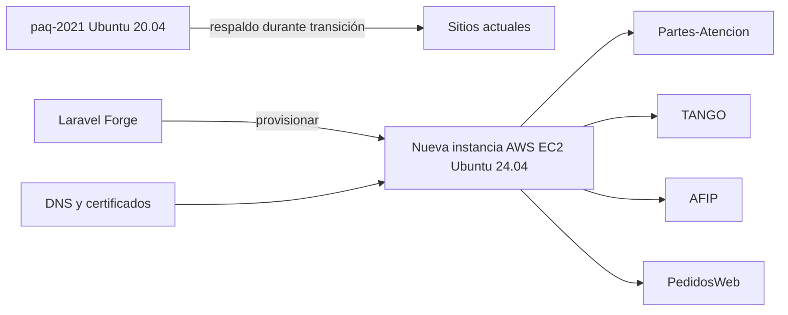

# Plan de migración selectiva de Forge

## Contexto

El servidor `paq-2021` usa Ubuntu 20.04 y no puede recibir los parches actuales
de PHP. La solución es adquirir, desde Laravel Forge, una nueva instancia AWS
EC2 con Ubuntu 24.04 y PHP 8.2/8.3. La instancia actual permanecerá activa
durante toda la transición.

## Fase 0 — Preparación e infraestructura

- Inventariar dominios, repositorios, ramas, `.env`, bases, colas, cron,
  storage, certificados y health checks de los proyectos incluidos.
- Confirmar backups de código, variables, bases y archivos persistentes.
- Crear desde Forge un nuevo servidor AWS/EC2:
  - región preferentemente Ohio, como el servidor actual;
  - Ubuntu 24.04 LTS;
  - tamaño igual o superior al actual;
  - firewall, claves SSH y reglas de red;
  - PHP 8.2 o 8.3;
  - Composer y Node.js LTS.
- Instalar y verificar:
  - `sqlsrv` y `pdo_sqlsrv`;
  - extensiones PHP requeridas por Laravel/Sanctum;
  - autenticación Cloudsmith;
  - Redis, Supervisor, Nginx, PHP-FPM y cron si corresponden;
  - acceso a SQL Server, MySQL y otros servicios externos.
- Crear primero los sitios del punto 1 y probarlos antes de cambiar DNS.
- No eliminar sitios ni apagar `paq-2021`.

Referencias:

- [`docs/06-operacion/cd-framework-vercel-forge.md`](docs/06-operacion/cd-framework-vercel-forge.md)
- [`docs/06-operacion/deploy-infraestructura.md`](docs/06-operacion/deploy-infraestructura.md)
- [`backend/scripts/forge-composer-install.sh`](backend/scripts/forge-composer-install.sh)

## Punto 1 — Partes-Atencion

Sitios:

- `partesatencion-paqsystems.on-forge.com` — producción, rama `main`.
- `partesatencion-paqsystems-dev.on-forge.com` — desarrollo, rama `develop`.

Pasos:

- Crear ambos sitios en el nuevo servidor.
- Configurar repositorios, ramas, document root, deploy scripts y `.env`.
- Configurar Cloudsmith y ejecutar `scripts/forge-composer-install.sh`.
- Configurar bases, storage, colas, cron y health checks.
- Desplegar primero desarrollo.
- Validar login, endpoints, permisos, datos, archivos, colas y tareas.
- Desplegar producción.
- Validar health check y smoke test.
- Cambiar DNS solo luego de validar producción.
- Observar logs y errores.

**Gate P1:** producción y desarrollo operativos, sin errores críticos, con
health checks correctos y rollback documentado. No comenzar P2 sin OK explícito.

## Punto 2 — TANGO

Sitios:

- `tango-paqsystems.on-forge.com` — producción, rama `main`.
- `tango-paqsystems-dev.on-forge.com` — desarrollo, rama `develop`.
- `backenddevtangopaqsystems.on-forge.com` — `FRAMEWORK`, integración.
- `backendtangopaqsystems.on-forge.com` — sitio antiguo/unificado; evaluar
  si se conserva temporalmente o se discontinúa al consolidar los anteriores.

Pasos adicionales:

- Verificar PHP 8.2/8.3 y `sqlsrv`/`pdo_sqlsrv` en CLI y FPM.
- Configurar `DB_*`, `DB_TENANTS_*`, `DB_COMPANY_DATABASE`,
  `AGENT_GATEWAY_*`, `CLOUDSMITH_READ_TOKEN` y demás variables.
- Validar Tenants Catalog, Dictionary DB y todas las Company DB.
- Ejecutar `backend/scripts/deploy-forge.sh`.
- Confirmar migraciones pendientes en cada base.
- Validar Agent Gateway, Sanctum, `X-Company-Id`, empresas, menús,
  permisos, colas, `schedule:run`, storage y certificados.
- Revisar el flujo de la rama `FRAMEWORK` antes de activarlo.
- Ejecutar `node scripts/check-sdk-deploy-mode.mjs` antes de un deploy release.

**Gate P2:** producción, desarrollo y FRAMEWORK validados; migraciones y
conexiones multiempresa correctas. No comenzar P3 sin OK explícito.

## Punto 3 — AFIP

Se migran ambos entornos:

- `afip.paqsystems.ar` — producción, rama `afip_produccion`.
- `afip_desarrollo.paqsystems.ar` — desarrollo, rama `afip_desarrollo`.

Pasos:

- Crear los sitios en el nuevo servidor.
- Configurar repositorios, ramas, PHP, Composer, variables y bases.
- Desplegar y validar primero desarrollo.
- Validar autenticación, operaciones AFIP, certificados y tareas.
- Desplegar producción.
- Validar endpoints, certificados, cron, colas, logs y smoke test.
- Actualizar DNS después de la validación.

**Gate P3:** ambos entornos AFIP validados y con rollback disponible. No
comenzar P4 sin OK explícito.

## Punto 4 — PedidosWeb

Migrar todos estos sitios:

- `backankas.on-forge.com`.
- `backpedidoswebprueba.on-forge.com`.
- `backquentopedidosweb.on-forge.com`.
- `lacapolpedidosweb.on-forge.com`.
- `expcolorpedidosweb.on-forge.com`.
- `demopedidosweb.on-forge.com`.
- `iapedidoswebquentodemo.on-forge.com`.

Pasos:

- Crear cada sitio con su repositorio, rama y variables independientes.
- Mantener separadas las bases y configuraciones de cada cliente.
- Migrar primero demos y pruebas; luego producción.
- Validar Composer, Laravel, storage, colas, migraciones, seeders y health
  checks.
- Revisar antes de ejecutar scripts que incluyan `artisan migrate` o
  `paqsuite:seed-deploy`.
- Actualizar Node.js solo si algún frontend se compila en el servidor;
  si compila en Vercel, no duplicar el build en Forge.
- Cambiar DNS sitio por sitio después de validar.

**Gate P4:** todos los sitios PedidosWeb operativos en la nueva instancia.

## Cierre

Después del OK de P4:

- Mantener `paq-2021` en observación durante el período acordado.
- Verificar que ningún DNS, cron, cola, deploy hook o integración apunte al
  servidor antiguo.
- Revocar claves y accesos antiguos cuando corresponda.
- Tomar backup final.
- Eliminar la instancia AWS y el servidor Forge antiguos solo con aprobación
  final.

## Sitios que quedarían discontinuados

No se migrarán:

- `clientes.paqsystems.ar` — repositorio `sistema-partes`.
- `clientes2021.prueba.paqsystems.ar` — `PaqSuiteWeb1.0Backend`.
- `clientes2023prueba.paqsystems.ar` — `PaqSuiteWeb1.0FrontEnd`.

También se deberá decidir si `backendtangopaqsystems.on-forge.com` se
discontinúa al consolidar TANGO en producción, desarrollo y FRAMEWORK. Todo
sitio no incluido en Partes-Atencion, TANGO, AFIP o PedidosWeb queda fuera de
alcance y se preparará para baja.

## Verificación obligatoria en cada gate

- Deploy desde la rama correcta.
- PHP CLI y FPM en versión soportada.
- Composer y Cloudsmith funcionando.
- HTTPS y certificados válidos.
- Health check correcto.
- Login y operación principal.
- Bases y migraciones verificadas.
- Colas, Supervisor y cron funcionando.
- Logs sin errores críticos.
- DNS y rollback documentados.
- OK explícito antes de iniciar el siguiente punto.
